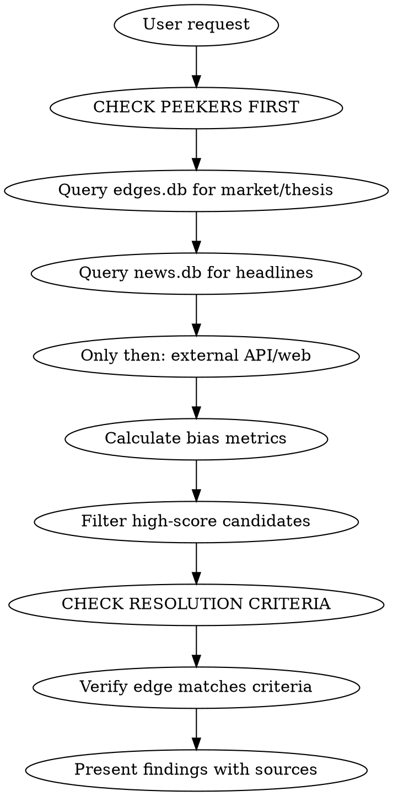

# Polymarket Edge Scanner

## First Use: Check Stage

**Before doing anything else, detect user's stage:**

```bash
cd ~/.claude/thesis-tracker-tools && bun run mentor --json
```

| Stage | Action |
|-------|--------|
| `setup` | Invoke `polymarket-mentor` skill - guide through config and daemon setup |
| `learning` | Invoke `polymarket-mentor` skill - guide through first edge together |
| `active` | Proceed with normal workflow |
| `reflection` | Mention resolved market, offer to review ("let's review" to dig in) |

**Philosophy reminder:** If user asks "what should I bet on?" - invoke mentor skill for the philosophy injection. We find facts, THEY develop thesis.

## Overview

Systematic methodology for finding and managing edges on Polymarket:
1. **Mispriced bets** - Markets where cognitive biases create clear mispricings
2. **Cheap lottery tickets** - Longshots where current reality suggests better odds than priced
3. **Portfolio tracking** - Monitor positions, P&L, and get hedge/exit advice via CLOB API

## When to Use

- User asks to "scan Polymarket" or "find mispriced bets"
- User wants to find "cheap lottery tickets" or underpriced longshots
- User wants to analyze prediction market opportunities
- User mentions cognitive bias, recency bias, or market inefficiencies
- User wants to research specific market categories (AI, politics, sports, crypto)
- User wants to track portfolio, monitor positions, or get exit/hedge advice

## Gamma API Quick Reference

**Base URL:** `https://gamma-api.polymarket.com`

| Endpoint | Use |
|----------|-----|
| `/markets?closed=false&active=true&limit=100` | Fetch active markets |
| `/events?closed=false&active=true&limit=500` | Fetch events (grouped markets) |

**Key fields:**
- `outcomePrices`: JSON array `["0.45", "0.55"]` for YES/NO
- `oneDayPriceChange`, `oneWeekPriceChange`, `oneMonthPriceChange`: Price momentum
- `volumeNum`, `liquidityNum`: Market depth
- `bestBid`, `bestAsk`: Current spread
- `slug`: URL slug for constructing market links

**Constructing Polymarket URLs:**
```
https://polymarket.com/event/{slug}
```
Example: slug `will-arsenal-win-the-202526-english-premier-league` becomes:
`https://polymarket.com/event/will-arsenal-win-the-202526-english-premier-league`

## Workflow

**PEEKERS FIRST:** Always check local databases before external APIs/web searches.



### Peekers First Rule

**Always query local databases before external sources:**

```bash
# 1. Check edges.db for existing market data and thesis
sqlite3 ~/.claude/polymarket-edges/edges.db \
  "SELECT * FROM markets WHERE question LIKE '%keyword%'"

sqlite3 ~/.claude/polymarket-edges/edges.db \
  "SELECT * FROM thesis_history WHERE market_slug LIKE '%keyword%'"

# 2. Check news.db for relevant headlines
sqlite3 ~/.claude/polymarket-news/news.db \
  "SELECT title, source, datetime(published_at,'unixepoch','localtime')
   FROM headlines WHERE lower(title) LIKE '%keyword%'
   ORDER BY published_at DESC LIMIT 10"

# 3. Only if local data insufficient, use Gamma API or web search
```

**Why:** Local peekers have your portfolio context, saved theses, and curated news. Faster and more relevant than cold API calls.

**Note:** The resolution criteria check is critical. Leaks and news don't matter if they don't meet the market's official resolution standard.

### Step 1: Fetch Markets

**Filter by Tag (Recommended):** Use `tag_slug` parameter for efficient category filtering.

```bash
# Filter by tag slug (most efficient)
curl -s "https://gamma-api.polymarket.com/events?closed=false&active=true&tag_slug=tech&limit=50"
curl -s "https://gamma-api.polymarket.com/events?closed=false&active=true&tag_slug=politics&limit=50"
curl -s "https://gamma-api.polymarket.com/events?closed=false&active=true&tag_slug=trump-presidency&limit=50"

# Common tag slugs:
# tech, politics, trump-presidency, doge, courts, crypto, ukraine
# uk, geopolitics, economy, sports, global-elections, creators
```

**Available tags:**
```bash
# List all tags in current events
curl -s "https://gamma-api.polymarket.com/events?closed=false&active=true&limit=20" | \
  jq '[.[].tags] | flatten | unique | .[] | {label, slug}'
```

**Other filtering methods:**
```bash
# All active markets
curl -s "https://gamma-api.polymarket.com/markets?closed=false&active=true&limit=100"

# Filter by regex (use jq)
curl -s "https://gamma-api.polymarket.com/events?closed=false&active=true&limit=500" | \
  jq '[.[] | select(.title | test("AI|crypto|election"; "i"))]'

# Get specific fields
curl -s "https://gamma-api.polymarket.com/markets?closed=false&active=true&limit=200" | \
  jq '.[] | {question, outcomePrices, volumeNum, liquidityNum, oneDayPriceChange, oneWeekPriceChange}'
```

### Step 2: Calculate Bias Metrics

**Cognitive biases to detect:**

| Bias | Detection Method | Trading Edge |
|------|------------------|--------------|
| **Recency Bias** | `abs(oneWeekPriceChange) > 0.10` | Mean reversion after sharp moves |
| **Longshot Bias** | YES price 1-15% | Low-prob events overpriced; sell NO |
| **Availability Bias** | High `volume24hr/volume1wk` ratio | News-driven overreaction |
| **Favorite-Longshot** | YES price 85-99% | Favorites slightly underpriced |
| **Momentum/Bandwagon** | Large moves + high recent volume | Crowded trades may reverse |

**Mispricing score formula:**
```
score = 0
if reversion_candidate: score += 15-20
if longshot (1-15%): score += 15
if momentum_score > 0.3: score += 10-15
if volume_spike > 2x: score += 10
if wide_spread > 5%: score += 10
if thin_liquidity < $5k: score *= 0.5  # penalize
```

### Step 3: Research Top Candidates

For each high-scoring market:

1. **WebSearch** for recent news on the topic
2. **CHECK RESOLUTION CRITERIA** (see critical section below)
3. **Cross-reference** market price vs. news reality
4. **Identify edge type:**
   - Hard news not yet priced in
   - Technical/domain knowledge
   - Statistical/historical base rates
   - Overreaction to recent events

## CRITICAL: Always Check Resolution Criteria

**Before recommending ANY bet, fetch and verify the market's resolution criteria.**

```bash
# Get market description with resolution rules
curl -s "https://gamma-api.polymarket.com/events?slug={event-slug}" | \
  jq '.[0].markets[] | {question, description}'
```

### Why This Matters

**Case Study: Claude 5 Market (Feb 2026)**

| What We Thought | Reality |
|-----------------|---------|
| Leak showed `claude-sonnet-5@20260203` | Anthropic announced "Sonnet 4.6" officially |
| MLQ.ai reported "Sonnet 5 launched Feb 3" | Resolution requires "explicitly named Claude 5" |
| Initial call: YES at 10.8% | Correct call: PASS - market fairly priced |

**The resolution criteria stated:**
> "Claude 5 refers to a product **explicitly named Claude 5**... Products labeled as Claude 4.5 or similar **will not count**"

**Lesson:** Internal leaks, API names, and news reports don't matter. Only **official naming** per resolution criteria matters.

### Resolution Criteria Red Flags

Watch for these in market descriptions:
- **"Officially announced"** - Rumors don't count
- **"Explicitly named"** - Internal versions don't count
- **"Publicly accessible"** - Private betas don't count
- **"Consensus of credible reporting"** - Single sources may not suffice

### Verification Checklist

Before finalizing any bet recommendation:
- [ ] Read full market description
- [ ] Identify exact resolution trigger
- [ ] Verify your "edge" matches resolution criteria
- [ ] Check if news/leaks meet the official standard

### Step 4: Present Findings

Structure output as:

```markdown
## [Market Name]

**Market:** [https://polymarket.com/event/{slug}](https://polymarket.com/event/{slug})

| Metric | Value |
|--------|-------|
| Current Price | X% YES |
| Weekly Change | +/-X% |
| Liquidity | $X |

**Bias Detected:** [Type]

**Analysis:** [Why mispriced]

**Edge:** [Information advantage]

**Bet:** [YES/NO at X cents]
```

**IMPORTANT:** Always include the Polymarket link so users can quickly access the market.

## Domain-Specific Scanning

### AI Markets
Search terms: `GPT|Claude|OpenAI|Anthropic|Gemini|AGI|Grok|xAI|benchmark|frontier`

Edge sources:
- Benchmark leaderboards (LMSYS, LLM Stats)
- Model release patterns
- Technical leaks (Vertex AI logs, API endpoints)
- Company financials/fundraising

### Crypto Markets
Search terms: `airdrop|token|ETH|Bitcoin|DeFi|NFT|chain`

Edge sources:
- On-chain data
- Protocol announcements
- Tokenomics analysis

### Politics Markets
Search terms: `election|president|nomination|congress|bill`

Edge sources:
- Polling aggregates
- Historical base rates
- Legislative calendars

## Lottery Ticket Scanning

**Note:** Lottery tickets are different from mispricings. These are TRUE LONGSHOTS where domain knowledge suggests the probability might be higher than market price, but they're still unlikely to win. Small bet, big potential return.

### What Makes a Good Lottery Ticket

| Criteria | Why It Matters |
|----------|----------------|
| Low price (1-15% YES) | Cheap entry, asymmetric upside |
| Current performance contradicts odds | Market hasn't updated to recent news |
| Domain knowledge edge | You know something the market doesn't |
| Clear resolution criteria | No ambiguity on payout |

### How to Find Lottery Tickets

```bash
# Filter for cheap YES prices (1-25%) with decent volume
curl -s "https://gamma-api.polymarket.com/events?closed=false&active=true&limit=500" | \
  jq '[.[] | .markets[]? | select(.outcomePrices) |
      {question, slug, prices: .outcomePrices, volume: .volumeNum, liquidity: .liquidityNum}] |
      map(select((.prices | fromjson)[0] | tonumber | . > 0.01 and . < 0.25)) |
      sort_by(-(.volume // 0)) | .[:50]'
```

### Case Studies

**Detroit Pistons NBA Finals (Feb 2026)**

| Market Said | Reality |
|-------------|---------|
| 8.5% YES | Best record in NBA (40-13) |
| Priced as longshot | #1 seed entering playoffs |

**Edge:** Market hadn't updated to reflect dominant season performance. The #1 team in the league shouldn't be priced at 8.5%.

**RC Lens Ligue 1 (Feb 2026)**

| Market Said | Reality |
|-------------|---------|
| 12% YES | Currently LEADING Ligue 1 |
| PSG historically dominant | Lens 1 point ahead of PSG |

**Edge:** Current league leaders priced as longshots due to PSG's historical dominance.

**Italy Winter Olympics Gold Medals**

| Market Said | Reality |
|-------------|---------|
| Low odds to win most golds | Only 2 medals behind leader |
| Few events remaining | High variance possible |

**Edge:** With few events left and small gap, one good day could swing it.

### Lottery Ticket vs Mispricing

| Type | Price | Edge | Expected Value |
|------|-------|------|----------------|
| **Mispricing** | Any | Market is wrong | Positive EV |
| **Lottery Ticket** | Low (1-15%) | Market may be slightly wrong | Uncertain EV, asymmetric payoff |

**Key difference:** Mispricings are bets where you believe the market is clearly wrong. Lottery tickets are longshots where you have reason to believe the odds are better than priced, but winning is still unlikely.

### Present Lottery Tickets Separately

```markdown
## LOTTERY TICKETS (Longshots with upside)

### [Market Name]
**Market:** [link]

| Metric | Value |
|--------|-------|
| Current Price | X% YES |
| Why Underpriced | [Current standings/news contradict low odds] |

**This is a LONGSHOT** - small bet, big potential return

**Edge:** [What you know that market may not reflect]
```

## Analytical Framework

Systematic edge detection using a three-layer hierarchy with versioned thesis tracking.

### Analysis Hierarchy

```
LAYER 1: CONTRARIAN → LAYER 2: SOURCE QUALITY → LAYER 3: BIAS SCORING
```

**Rule:** Contrarian beats all. Insider source beats bias scoring. Scoring helps when neither apply.

### Layer 1: Contrarian Detection

Four signals indicate "crowd is wrong":

| Signal | Detection | Threshold |
|--------|-----------|-----------|
| **Price Extreme** | YES >90% or <10% | Event >7 days out |
| **Volume Spike** | 24h volume vs weekly avg | >3x + >15% price move |
| **News Mismatch** | Headlines contradict price | Qualitative |
| **Echo Chamber** | Same narrative everywhere | 5+ sources |

**Scoring:** 0-1 = none, 2 = 🟡 possible, 3-4 = 🟢 strong contrarian

### Layer 2: Source Credibility

| Tier | Label | Examples |
|------|-------|----------|
| **Tier 1** | 🥇 Gold | Employee interview, leaked doc, court filing |
| **Tier 2** | 🥈 Silver | Journalist + named source, regulatory filing |
| **Tier 3** | 🥉 Bronze | Analyst opinion, aggregator summary |
| **Tier 4** | ⚪ Noise | Rumors, speculation, "sources say" |

**Rule:** Tier 1 + matches resolution criteria = 🟢 regardless of bias

### Layer 3: Bias Scoring

Six biases, each scored 0-10:

| Bias | Score Triggers | Counter-Thesis |
|------|----------------|----------------|
| **Recency** | Price moved >15% in 7d on digested news | "News is priced in because..." |
| **Availability** | High media coverage, low probability | "Headlines overstate because..." |
| **Anchoring** | Price stuck despite new info | "Market ignoring X..." |
| **Confirmation** | Contradictory evidence ignored | "Market dismissing Y..." |
| **Favorite-Longshot** | Extreme price without basis | "True probability is X%..." |
| **Bandwagon** | Volume spike + social buzz | "Crowd buying hype..." |

**Aggregate:** 0-20 = 🟢 low bias, 21-35 = 🟡 moderate, 36+ = 🔴 heavy bias

### Traffic Light Output

```
[SIGNAL] [MARKET] - [ONE-LINER]
└─ Contrarian: X/4 | Source: TierX | Bias: XX/60
```

**Signal Rules:**
- 🟢 **Green**: Contrarian 3+ OR (Tier 1-2 + bias >35) → Bet
- 🟡 **Yellow**: Contrarian 2 OR (Tier 2-3 + bias 21-35) → Watch
- 🔴 **Red**: Everything else → Pass

### Thesis Commands

```bash
# Save analysis
sqlite3 ~/.claude/polymarket-edges/edges.db \
  "INSERT INTO thesis_history (...) VALUES (...)"

# Get latest thesis for a market
sqlite3 ~/.claude/polymarket-edges/edges.db \
  "SELECT * FROM thesis_history WHERE market_slug = 'your-slug' ORDER BY created_at DESC LIMIT 1"

# Thesis drift detection
sqlite3 ~/.claude/polymarket-edges/edges.db \
  "SELECT m.question, t1.signal as original, t2.signal as current
   FROM thesis_history t1
   JOIN thesis_history t2 ON t1.market_slug = t2.market_slug
   JOIN markets m ON m.slug = t1.market_slug
   WHERE t1.id = (SELECT MIN(id) FROM thesis_history WHERE market_slug = t1.market_slug)
     AND t2.id = (SELECT MAX(id) FROM thesis_history WHERE market_slug = t1.market_slug)
     AND t1.signal != t2.signal"

# Calibration stats
sqlite3 ~/.claude/polymarket-edges/edges.db \
  "SELECT signal, COUNT(*) as total,
          SUM(CASE WHEN m.resolved_outcome = th.position_taken THEN 1 ELSE 0 END) as wins
   FROM thesis_history th
   JOIN markets m ON m.slug = th.market_slug
   WHERE m.resolved = 1 AND th.position_taken != 'pass'
   GROUP BY signal"
```

### Example Analysis Output

```
🟢 US Strikes Iran Feb 28 (26%) - Contrarian 3/4, Tier 2 source confirms military prep
└─ Contrarian: 3/4 | Source: Tier2 | Bias: 38/60

CONTRARIAN SIGNALS: price extreme (26%), news mismatch, echo chamber
SOURCE: 🥈 CNN Pentagon correspondent citing defense officials (Feb 19)
BIASES: Recency 6, Availability 8, Anchoring 7, Confirmation 5, FavLong 6, Bandwagon 6

THESIS: Market stuck at 26% despite multiple credible reports of imminent strike.
Recency bias: Feb 14 "talks progressing" news still anchoring price.
Availability bias: Peace narrative dominates headlines but Pentagon sources say otherwise.
Resolution criteria requires "US military strike" - cruise missiles or airstrikes qualify.
```

## Risk Warnings

Always note in output:
1. **Thin liquidity** - Wide spreads make execution difficult
2. **Resolution risk** - Ambiguous criteria can cause disputes
3. **Timing risk** - Being right but early still loses
4. **NOT financial advice** - Analysis only

## Example Session

User: "Scan AI markets for mispriced bets"

1. Fetch AI-related events:
```bash
curl -s "https://gamma-api.polymarket.com/events?closed=false&active=true&limit=500" | \
  jq '[.[] | select(.title | test("GPT|Claude|OpenAI|Anthropic|AGI|Grok"; "i"))]'
```

2. Calculate metrics for each market

3. WebSearch top candidates:
   - "Claude 5 release date 2026"
   - "GPT-6 OpenAI timeline"
   - "LMSYS Chatbot Arena rankings February 2026"

4. Cross-reference and present findings with sources

## Portfolio Tracking & Management

Track positions, monitor P&L, and get advice on hedging or exiting.

### Two Methods to Track a Portfolio

#### Method 1: By Polymarket Username (Recommended - No Credentials Needed)

The easiest way. User provides their Polymarket profile username (e.g., `@JohnDoe` from `polymarket.com/@JohnDoe`).

```bash
# Step 1: Fetch profile page to get wallet address
# Use WebFetch tool on: https://polymarket.com/profile/@USERNAME
# Extract the wallet/proxy address from the profile

# Step 2: Get positions using the extracted address
curl -s "https://data-api.polymarket.com/positions?user=0xWALLET_ADDRESS" | \
  jq '[.[] | select(.currentValue > 0.5) | {title, outcome, size, avgPrice, curPrice, currentValue, cashPnl, percentPnl, endDate}] | sort_by(-.currentValue)'
```

**Example:**
```
User: "Track my portfolio, username is JohnDoe"
1. WebFetch https://polymarket.com/profile/@JohnDoe
2. Extract address: 0x1234567890abcdef...
3. Fetch positions from Data API
4. Generate portfolio report with recommendations
```

#### Method 2: By Wallet Address with CLOB API (Requires Developer Credentials)

For users who want to derive their proxy wallet programmatically or enable trading capabilities.

**Requirements:**
- Private key (for signing)
- CLOB API credentials (derived from private key)

```typescript
import { ClobClient } from "@polymarket/clob-client";
import { privateKeyToAccount } from "viem/accounts";
import { keccak256, getCreate2Address, encodePacked } from "viem";

// Constants for proxy wallet derivation
const PROXY_FACTORY = "0xaB45c5A4B0c941a2F231C04C3f49182e1A254052";
const PROXY_INIT_CODE_HASH = "0x..."; // From Polymarket docs

// Derive proxy wallet from EOA
function deriveProxyAddress(eoaAddress: string): string {
  return getCreate2Address({
    bytecodeHash: PROXY_INIT_CODE_HASH,
    from: PROXY_FACTORY,
    salt: keccak256(encodePacked(["address"], [eoaAddress])),
  });
}

// Or resolve ENS first
// curl -s "https://api.ensideas.com/ens/resolve/username.eth" | jq '.address'
```

**When to use Method 2:**
- User wants to execute trades programmatically
- User only knows their EOA address (not proxy wallet)
- Building automated trading/rebalancing tools

### API Endpoints

| API | Base URL | Use |
|-----|----------|-----|
| **Data API** | `https://data-api.polymarket.com` | Positions, P&L, holdings value |
| **CLOB API** | `https://clob.polymarket.com` | Trading, orders, authentication |
| **Gamma API** | `https://gamma-api.polymarket.com` | Market data, prices |

### Get User Positions

```bash
# Get all positions for a wallet address
curl -s "https://data-api.polymarket.com/positions?user=0xYOUR_ADDRESS" | \
  jq '.[] | {title, outcome, size, avgPrice, curPrice, currentValue, cashPnl, percentPnl, endDate}'

# Get positions sorted by value (active positions only)
curl -s "https://data-api.polymarket.com/positions?user=0xADDRESS" | \
  jq '[.[] | select(.currentValue > 0.5)] | sort_by(-.currentValue)'

# Get positions sorted by P&L
curl -s "https://data-api.polymarket.com/positions?user=0xADDRESS&sortBy=PERCENTPNL&sortDirection=DESC"
```

### Authentication Setup (for Trading - Method 2 only)

```typescript
import { ClobClient } from "@polymarket/clob-client";
import { createWalletClient, http } from "viem";
import { privateKeyToAccount } from "viem/accounts";
import { polygon } from "viem/chains";

// Derive wallet from private key
const account = privateKeyToAccount(process.env.PRIVATE_KEY as `0x${string}`);

// Initialize CLOB client
const client = new ClobClient(
  "https://clob.polymarket.com",
  137, // Polygon mainnet
  account
);

// Get or create API credentials (L2 auth)
const credentials = await client.createOrDeriveApiKey();
// Returns: { apiKey, secret, passphrase }
```

### Portfolio Analysis Script

```typescript
interface Position {
  market: string;
  outcome: "Yes" | "No";
  size: number;
  avgPrice: number;
  currentPrice: number;
  pnl: number;
  pnlPercent: number;
}

async function analyzePortfolio(address: string): Promise<{
  positions: Position[];
  advice: string[];
}> {
  const res = await fetch(`https://data-api.polymarket.com/positions?user=${address}`);
  const positions = await res.json();

  const advice: string[] = [];

  for (const pos of positions) {
    const pnlPercent = ((pos.curPrice - pos.avgPrice) / pos.avgPrice) * 100;

    // Take profit signals
    if (pnlPercent > 50) {
      advice.push(`🟢 TAKE PROFIT: ${pos.market.question} (+${pnlPercent.toFixed(1)}%)`);
    }

    // Stop loss signals
    if (pnlPercent < -30) {
      advice.push(`🔴 STOP LOSS: ${pos.market.question} (${pnlPercent.toFixed(1)}%)`);
    }

    // Near expiry warnings
    const daysToExpiry = (new Date(pos.market.endDate) - Date.now()) / (1000*60*60*24);
    if (daysToExpiry < 7 && pos.curPrice > 0.3 && pos.curPrice < 0.7) {
      advice.push(`⚠️ EXPIRING SOON: ${pos.market.question} - ${daysToExpiry.toFixed(0)} days left`);
    }

    // High conviction exits (price near 0 or 1)
    if (pos.curPrice > 0.95 || pos.curPrice < 0.05) {
      advice.push(`💰 NEAR RESOLUTION: ${pos.market.question} at ${(pos.curPrice*100).toFixed(1)}%`);
    }
  }

  return { positions, advice };
}
```

### Portfolio Commands

```bash
# Get positions sorted by P&L
curl -s "https://data-api.polymarket.com/positions?user=0xADDRESS&sortBy=PERCENTPNL&sortDirection=DESC"

# Get total portfolio value
curl -s "https://data-api.polymarket.com/value?user=0xADDRESS"

# Get positions for specific market
curl -s "https://data-api.polymarket.com/positions?user=0xADDRESS&market=MARKET_ID"
```

### Position Monitoring Signals

| Signal | Condition | Action |
|--------|-----------|--------|
| **Take Profit** | P&L > +50% | Consider selling partial/full |
| **Stop Loss** | P&L < -30% | Evaluate exit or double down |
| **Expiry Warning** | <7 days, price 30-70% | Decide: hold or exit |
| **Near Resolution** | Price >95% or <5% | Lock in gains/cut losses |
| **Hedge Alert** | Correlated positions | Reduce exposure |
| **Liquidity Warning** | Spread >5% | Difficult to exit at fair price |

### Hedge Detection

Look for correlated positions that multiply risk:

```bash
# Example: User has both
# - "Trump wins 2028" YES
# - "Republican wins 2028" YES
# These are correlated - winning one likely means winning both
# Suggest: "Consider hedging - both positions win/lose together"
```

### Portfolio Report Format

```markdown
## Portfolio Summary

**Total Value:** $X,XXX
**Open Positions:** N
**Unrealized P&L:** +/-$XXX (+/-X%)

### Positions Needing Attention

| Market | Position | Entry | Current | P&L | Signal |
|--------|----------|-------|---------|-----|--------|
| [Market] | YES | $0.XX | $0.XX | +X% | 🟢 TAKE PROFIT |

### Recommendations

1. **SELL:** [Market] - Up 60%, lock in gains
2. **MONITOR:** [Market] - Expires in 5 days
3. **HEDGE:** [Market A] and [Market B] are correlated
```

### Environment Setup

```bash
# Required env vars
export POLYMARKET_PRIVATE_KEY="0x..."  # Your wallet private key
export POLYMARKET_ADDRESS="0x..."      # Your wallet address

# Optional: Store API credentials after first derivation
export POLYMARKET_API_KEY="..."
export POLYMARKET_API_SECRET="..."
export POLYMARKET_API_PASSPHRASE="..."
```

### Dependencies

```json
{
  "dependencies": {
    "@polymarket/clob-client": "^4.0.0",
    "viem": "^2.0.0"
  }
}
```

## News Feed Scanner

A background daemon that collects headlines from RSS feeds and stores them in SQLite for real-time market analysis.

### Architecture

```
┌──────────────────┐     writes      ┌──────────────────┐
│  News Daemon     │ ──────────────► │  news.db         │
│  (Bun binary)    │                 │  (SQLite)        │
│  runs every 10m  │                 └────────┬─────────┘
└──────────────────┘                          │ reads
                                              ▼
                                    ┌──────────────────┐
                                    │  Edge Scanner    │
                                    │  Skill           │
                                    └──────────────────┘
```

### Setup

1. **Build the daemon:**
```bash
cd ~/.claude/polymarket-news
bun install
bun run build  # Creates standalone binary
```

2. **Configure feeds** (edit `~/.claude/polymarket-news/config.json`):
```json
{
  "daemon": { "intervalMinutes": 10 },
  "storage": { "maxSizeBytes": 419430400, "maxAgeDays": 7 },
  "feeds": {
    "geopolitics": { "enabled": true, "sources": [...] },
    "tech": { "enabled": true, "sources": [...] },
    "crypto": { "enabled": false, "sources": [...] }
  }
}
```

3. **Run the daemon:**
```bash
# Foreground (for testing)
./polymarket-news-daemon

# Background
nohup ./polymarket-news-daemon > daemon.log 2>&1 &
```

### Storage Management

The daemon automatically manages both database and log file sizes.

| Setting | Default | Description |
|---------|---------|-------------|
| `maxSizeBytes` | 400MB | Hard limit on news.db size |
| `maxAgeDays` | 7 | Auto-delete headlines older than this |
| `pruneAt` | 0.9 | Start pruning at 90% capacity |
| `targetAfterPrune` | 0.8 | Prune down to 80% capacity |
| `maxLogSizeBytes` | 10MB | Log rotation threshold |

**Log rotation:** When `daemon.log` exceeds `maxLogSizeBytes`, it's rotated to `daemon.log.old` (keeping only 1 backup).

### Querying Headlines

**From the skill (bash):**
```bash
# Recent headlines by topic
sqlite3 ~/.claude/polymarket-news/news.db \
  "SELECT source, title, datetime(published_at, 'unixepoch')
   FROM headlines
   WHERE relevance_tags LIKE '%iran%'
   ORDER BY published_at DESC LIMIT 10"

# Headlines from last 6 hours
sqlite3 ~/.claude/polymarket-news/news.db \
  "SELECT source, title FROM headlines
   WHERE published_at > strftime('%s', 'now', '-6 hours')
   ORDER BY published_at DESC"

# Count by tag
sqlite3 ~/.claude/polymarket-news/news.db \
  "SELECT json_each.value as tag, COUNT(*) as count
   FROM headlines, json_each(relevance_tags)
   GROUP BY tag ORDER BY count DESC"
```

### Edge Detection with News

When analyzing a market, query the news database:

1. Search for headlines matching market keywords
2. Compare news sentiment vs current market price
3. Flag mismatches as potential edges

| Headlines Say | Market Price | Signal |
|---------------|--------------|--------|
| "imminent", "confirmed" | < 30% YES | 🔴 Underpriced |
| "denied", "unlikely" | > 70% YES | 🔴 Overpriced |
| Mixed/neutral | 30-70% | ✅ Fairly priced |

**Example workflow:**
```bash
# User asks about Iran market
# 1. Check current price
curl -s "https://gamma-api.polymarket.com/events?slug=us-strikes-iran-by" | jq '.[0].markets[] | select(.question | test("February 28")) | .outcomePrices'

# 2. Check recent news
sqlite3 ~/.claude/polymarket-news/news.db \
  "SELECT title FROM headlines WHERE relevance_tags LIKE '%iran%' AND published_at > strftime('%s', 'now', '-24 hours')"

# 3. Compare and assess edge
```

### Default RSS Sources

**Geopolitics (Priority 1):**
- Reuters World, BBC World, Al Jazeera

**Tech:**
- Ars Technica, The Verge, TechCrunch

**Finance:**
- CNBC

**Crypto:**
- CoinDesk, The Block

**Sports (disabled by default):**
- ESPN, BBC Sport

### Adding Custom Sources

Edit `~/.claude/polymarket-news/config.json`:
```json
{
  "feeds": {
    "custom_category": {
      "enabled": true,
      "sources": [
        { "name": "My Source", "url": "https://example.com/rss", "priority": 2 }
      ]
    }
  },
  "keywords": {
    "patterns": [
      { "match": "my-keyword|related-term", "tag": "mytag" }
    ]
  }
}
```

### Troubleshooting

```bash
# Check if daemon is running
pgrep -f polymarket-news-daemon

# Check DB size
du -h ~/.claude/polymarket-news/news.db

# View recent logs
tail -50 ~/.claude/polymarket-news/daemon.log

# Count headlines
sqlite3 ~/.claude/polymarket-news/news.db "SELECT COUNT(*) FROM headlines"

# Force prune
sqlite3 ~/.claude/polymarket-news/news.db \
  "DELETE FROM headlines WHERE published_at < strftime('%s', 'now', '-7 days'); VACUUM;"
```

## Market Peeker (Edges Cache)

Background daemon that tracks watched markets and portfolio positions, storing price history for trend analysis.

### Architecture

```
┌──────────────────┐     writes      ┌──────────────────┐
│  Market Peeker   │ ──────────────► │  edges.db        │
│  (Bun binary)    │                 │  (SQLite)        │
│  adaptive refresh│                 └────────┬─────────┘
└──────────────────┘                          │ reads
        │                                     ▼
        │ syncs                     ┌──────────────────┐
        ▼                           │  Edge Scanner    │
┌──────────────────┐                │  Skill           │
│  Your Portfolio  │                └──────────────────┘
│  (Polymarket)    │
└──────────────────┘
```

### Setup

1. **Build the daemon:**
```bash
cd ~/.claude/polymarket-edges
bun install
bun run build
```

2. **Configure** (edit `~/.claude/polymarket-edges/config.json`):
```json
{
  "portfolio": {
    "wallet": "0xYOUR_WALLET_ADDRESS",
    "syncIntervalMinutes": 60
  }
}
```

3. **Run:**
```bash
./polymarket-edges-daemon          # Foreground
nohup ./polymarket-edges-daemon &  # Background
```

### Adaptive Refresh

Markets are refreshed based on time to expiry:

| Expiry | Refresh Rate |
|--------|--------------|
| < 24 hours | Every 10 min |
| < 7 days | Every 30 min |
| > 7 days | Every 2 hours |

### Watchlist Sources

Markets are auto-added to tracking from:
- **Portfolio**: Any market you hold a position in
- **Analyzed**: Any market you analyze via the skill
- **Manual**: Explicit "watch this" command

### Querying the Cache

```bash
# List watched markets
sqlite3 ~/.claude/polymarket-edges/edges.db \
  "SELECT slug, question, yes_price, in_portfolio FROM markets WHERE resolved = 0"

# Markets in your portfolio
sqlite3 ~/.claude/polymarket-edges/edges.db \
  "SELECT question, portfolio_outcome, portfolio_size, yes_price
   FROM markets WHERE in_portfolio = 1"

# Find correlated markets by tag
sqlite3 ~/.claude/polymarket-edges/edges.db \
  "SELECT question, tags FROM markets
   WHERE tags LIKE '%iran%' AND resolved = 0"

# Price history for a market
sqlite3 ~/.claude/polymarket-edges/edges.db \
  "SELECT datetime(recorded_at, 'unixepoch'), yes_price
   FROM price_history
   WHERE market_slug = 'your-market-slug'
   ORDER BY recorded_at DESC LIMIT 24"

# Markets with edge analysis
sqlite3 ~/.claude/polymarket-edges/edges.db \
  "SELECT question, edge_type, edge_direction, confidence, thesis
   FROM markets WHERE edge_type IS NOT NULL"
```

### Saving Edge Analysis

When analyzing a market via the skill, save the thesis:

```sql
-- Example: save edge analysis for a market
UPDATE markets SET
  edge_type = 'mispricing',
  edge_direction = 'yes_underpriced',
  thesis = 'News shows strike imminent but market at 26%',
  confidence = 'high',
  thesis_updated = strftime('%s', 'now')
WHERE slug = 'us-strikes-iran-by-february-28-2026';
```

### Correlation Detection

Markets are correlated by shared tags, weighted by portfolio:

```bash
# Find markets related to your Iran positions
sqlite3 ~/.claude/polymarket-edges/edges.db \
  "SELECT m2.question, m2.yes_price, m2.tags
   FROM markets m1, markets m2
   WHERE m1.slug = 'your-iran-market'
   AND m1.tags LIKE '%iran%'
   AND m2.tags LIKE '%iran%'
   AND m2.slug != m1.slug"
```

### Storage Limits (Lean Footprint)

| Setting | Default | Description |
|---------|---------|-------------|
| `maxSizeBytes` | 50MB | Hard limit on edges.db |
| `maxWatchedMarkets` | 200 | Max tracked markets |
| `maxPriceHistoryDays` | 7 | Price history retention |
| `resolvedRetentionDays` | 7 | Keep resolved markets |
| `maxLogSizeBytes` | 5MB | Log rotation threshold |

**Typical footprint:** ~50KB-2MB

### Troubleshooting

```bash
# Check if daemon is running
pgrep -f polymarket-edges-daemon

# Check DB size
du -h ~/.claude/polymarket-edges/edges.db

# View stats
sqlite3 ~/.claude/polymarket-edges/edges.db \
  "SELECT
    COUNT(*) as total,
    SUM(in_portfolio) as portfolio,
    SUM(edge_type IS NOT NULL) as with_edge
   FROM markets WHERE resolved = 0"

# View recent logs
tail -50 ~/.claude/polymarket-edges/daemon.log
```

## CLI Tools

TypeScript-based tools for common analysis tasks. All tools support `--json` flag for AI consumption.

### Available Tools

```bash
cd ~/.claude/thesis-tracker-tools

# Stage Detection & Onboarding
bun run mentor                        # Check stage, get guidance
bun run mentor --init                 # Interactive config setup
bun run mentor --json                 # JSON for AI parsing

# Thesis Drift Checker
bun run drift                         # Check for signal changes
bun run drift --json                  # JSON output

# KPI Tracker (Fear & Greed + BTC)
bun run kpi --record                  # Record current values
bun run kpi --view                    # View history
bun run kpi --view --limit 50         # View more history
```

### Output Modes

| Flag | Output | Use Case |
|------|--------|----------|
| (none) | Pretty terminal | Human reading |
| `--json` | Structured JSON | AI parsing, pipelines |

**Example JSON output (kpi):**
```json
{
  "mode": "view",
  "history": [
    { "name": "fear_greed", "value": 8, "classification": "Extreme Fear", "date": "2026-02-21" },
    { "name": "btc_price", "value": 97500, "classification": null, "date": "2026-02-21" }
  ]
}
```

## Developer Intern: Maintaining Tools

Guidelines for creating and modifying tools in `thesis-tracker-tools/`.

### Directory Structure

```
thesis-tracker-tools/
├── _template.ts      # Copy this for new tools
├── lib/
│   ├── output.ts     # Pretty vs JSON helpers
│   └── schemas.ts    # Zod schemas for external APIs
├── drift.ts          # Thesis drift detection
├── kpi.ts            # Fear & Greed + BTC tracking
├── mentor.ts         # Stage detection
├── personal/         # Your custom tools (gitignored)
└── package.json      # Add scripts here
```

### Tool Template Pattern

```typescript
import { parseArgs } from "util";
import { z } from "zod";
import { initDb } from "../src/storage";
import { output } from "./lib/output";
import { fetchAndValidate, SomeApiSchema } from "./lib/schemas";

// 1. Define result schema
const ResultSchema = z.object({ /* ... */ });
type ToolResult = z.infer<typeof ResultSchema>;

// 2. Core logic (pure, testable)
async function run(): Promise<ToolResult> {
  // Query DB or fetch external APIs
  return result;
}

// 3. Pretty formatter
function formatPretty(result: ToolResult): string {
  // Return formatted string
}

// 4. CLI entry
const { values } = parseArgs({
  args: Bun.argv.slice(2),
  options: { json: { type: "boolean", default: false } },
});

const result = await run();
output(result, { json: values.json, pretty: formatPretty });
```

### Conventions

| Rule | Why |
|------|-----|
| Zod schemas for ALL external APIs | Catches API drift at runtime |
| Return typed result, never print directly | Enables `--json` mode |
| Support `--json` flag | AI can parse output |
| Use `tools/lib/output.ts` helpers | Consistent formatting |
| One file per tool | Easy to find and modify |

### Adding a New Tool

1. Copy `_template.ts` to `<name>.ts`
2. Define result schema with Zod
3. Add external API schemas to `lib/schemas.ts` if needed
4. Implement `run()` function
5. Add pretty formatter
6. Add npm script to `package.json`:
   ```json
   "<name>": "bun run <name>.ts"
   ```
7. Test with both `--json` and pretty output

### External API Schemas

Add all external API schemas to `tools/lib/schemas.ts`:

```typescript
// Example: New API
export const NewApiResponse = z.object({
  data: z.array(z.object({
    id: z.string(),
    value: z.number(),
  })),
});

// Use with fetchAndValidate()
const data = await fetchAndValidate(url, NewApiResponse);
```

**Why Zod for external APIs:**
- Catches breaking changes immediately
- Clear error messages: "Expected string at data[0].id, got undefined"
- Single source of truth for types

**Why NOT Zod for database:**
- SQL schema already enforces structure
- TypeScript types in `types.ts` provide compile-time safety
- Redundant maintenance burden

### Testing Changes

```bash
# Test JSON output parses correctly
bun run <name> --json | jq .

# Test pretty output looks right
bun run <name>

# Test with different flags
bun run <name> --days 30 --json
```
